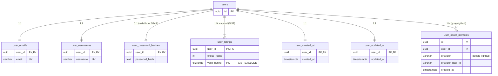
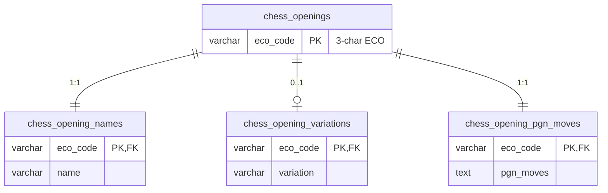

# ChessIQ v3.3.0 — Sixth Normal Form (6NF) Entity-Relationship Diagram

This document maps the complete **Sixth Normal Form (6NF)** relational architecture of ChessIQ across all 9 migrations ([000](file:///Users/abhijitsaha_2006/chess_project/db/migrations/000_init_extensions.sql) – [008](file:///Users/abhijitsaha_2006/chess_project/db/migrations/008_non_repeating_puzzles.sql)):

- **8 Core Anchor Domains** decomposed into **92+ binary 6NF tables** (each holding `(anchor_id, single_attribute)` or temporal `(id, value, valid_during tstzrange)` with GiST exclusion constraints)
- **8 Logical 3NF Reconstruction Views** (`v_users`, `v_chess_openings`, `v_games`, `v_game_analysis_jobs`, `v_game_analyses`, `v_move_analyses`, `v_training_puzzles`, `v_training_recommendations`)
- **2 PostgreSQL Stored Procedures** (`sp_ingest_game_analysis_6nf`, `sp_generate_user_training_recommendations`) + **Trigger** (`trg_notify_new_analysis_job`)

---

## 1. Master High-Level Entity-Relationship Overview

```mermaid
erDiagram
    users ||--o{ game_users : "owns"
    users ||--o{ user_game_move_signatures : "deduplicates"
    users ||--o{ user_oauth_identities : "links"
    users ||--o{ recommendation_users : "receives"

    chess_openings ||--o{ game_ecos : "classifies"

    games ||--|| game_users : "belongs_to"
    games ||--o| game_ecos : "tagged_with"
    games ||--|| job_games : "queued_in"
    games ||--o| game_analysis_games : "analyzed_by"

    game_analysis_jobs ||--|| job_games : "targets"
    game_analyses ||--|| game_analysis_games : "evaluates"
    game_analyses ||--o{ move_analysis_parents : "contains"
    move_analyses ||--|| move_analysis_parents : "ply_of"

    training_puzzles ||--o{ puzzle_themes : "tagged"
    puzzle_theme_types ||--o{ puzzle_themes : "categorizes"
    training_puzzles ||--o{ recommendation_puzzles : "recommended_as"
    training_recommendations ||--|| recommendation_users : "for_user"
    training_recommendations ||--o| recommendation_puzzles : "references"

    users {
        uuid id PK "Anchor"
    }
    chess_openings {
        varchar eco_code PK "ECO A00-E99"
    }
    games {
        uuid id PK "Anchor"
    }
    game_analysis_jobs {
        uuid id PK "Anchor"
    }
    game_analyses {
        uuid id PK "Anchor"
    }
    move_analyses {
        uuid id PK "Anchor"
    }
    training_puzzles {
        uuid id PK "Anchor"
    }
    training_recommendations {
        uuid id PK "Anchor"
    }
```

---

## 2. Domain 1 — Users, Authentication & Temporal Rating History (6NF)

> **View:** `v_users` joins `users` + `user_emails` + `user_usernames` + `LEFT JOIN user_password_hashes` + current active `user_ratings` (`upper(valid_during) IS NULL`).
> **Constraint:** `user_ratings` enforces `EXCLUDE USING gist (user_id WITH =, valid_during WITH &&)` so a user can never have overlapping active rating intervals.

---

## 3. Domain 2 — Openings Catalog (6NF)

> **View:** `v_chess_openings` reconstructs the 71 seeded ECO opening book lines used for book-move ACPL exclusion (`§11.5`).

---

## 4. Domain 3 — Games & Canonical Deduplication (6NF)

> **View:** `v_games` joins all 12 attribute tables + `LEFT JOIN game_ecos` + `LEFT JOIN game_white_elos` + `LEFT JOIN game_black_elos`.
> **Deduplication:** `user_game_move_signatures` enforces `PRIMARY KEY (user_id, move_signature)` using SHA-256 of canonical SAN moves so the same user cannot upload the same game twice (`409 Conflict`).

```mermaid
erDiagram
    games ||--|| game_users : "1:1"
    games ||--o| game_ecos : "0..1"
    games ||--|| game_white_players : "1:1"
    games ||--|| game_black_players : "1:1"
    games ||--o| game_white_elos : "0..1"
    games ||--o| game_black_elos : "0..1"
    games ||--|| game_results : "1:1"
    games ||--|| game_user_colors : "1:1"
    games ||--|| game_played_at : "1:1"
    games ||--|| game_pgn_raws : "1:1"
    games ||--|| game_move_signatures : "1:1"
    games ||--|| game_created_at : "1:1"
    users ||--o{ user_game_move_signatures : "1:N"

    games {
        uuid id PK
    }
    game_users {
        uuid game_id PK,FK
        uuid user_id FK
    }
    game_ecos {
        uuid game_id PK,FK
        varchar eco_code FK
    }
    game_white_players {
        uuid game_id PK,FK
        varchar white_player
    }
    game_black_players {
        uuid game_id PK,FK
        varchar black_player
    }
    game_white_elos {
        uuid game_id PK,FK
        int white_elo
    }
    game_black_elos {
        uuid game_id PK,FK
        int black_elo
    }
    game_results {
        uuid game_id PK,FK
        varchar result "1-0 | 0-1 | 1/2-1/2 | *"
    }
    game_user_colors {
        uuid game_id PK,FK
        varchar user_color "WHITE | BLACK"
    }
    game_played_at {
        uuid game_id PK,FK
        timestamptz played_at
    }
    game_pgn_raws {
        uuid game_id PK,FK
        text pgn_raw
    }
    game_move_signatures {
        uuid game_id PK,FK
        varchar move_signature "SHA-256"
    }
    user_game_move_signatures {
        uuid user_id PK,FK
        varchar move_signature PK
    }
    game_created_at {
        uuid game_id PK,FK
        timestamptz created_at
    }
```

---

## 5. Domain 4 — Asynchronous Stockfish Job Queue & Watchdog (6NF)

> **View:** `v_game_analysis_jobs` exposes active status (`upper(valid_during) IS NULL`), claim token lease, heartbeat, ply progress, and retry counts.
> **Trigger:** `trg_notify_new_analysis_job` on `job_statuses` fires `NOTIFY new_analysis_job` on `'pending'` insert.
> **Constraint:** `job_statuses` uses `EXCLUDE USING gist (job_id WITH =, valid_during WITH &&)` for atomic state transitions via `fn_transition_job_status`.

```mermaid
erDiagram
    game_analysis_jobs ||--|| job_games : "1:1"
    game_analysis_jobs ||--|{ job_statuses : "1:N temporal (GiST)"
    game_analysis_jobs ||--|| job_current_plies : "1:1"
    game_analysis_jobs ||--|| job_total_plies : "1:1"
    game_analysis_jobs ||--|| job_attempt_counts : "1:1"
    game_analysis_jobs ||--|| job_max_retries : "1:1"
    game_analysis_jobs ||--o| job_claim_tokens : "0..1 active lease"
    game_analysis_jobs ||--o| job_locked_by : "0..1 active lease"
    game_analysis_jobs ||--o| job_locked_at : "0..1 active lease"
    game_analysis_jobs ||--o| job_heartbeat_at : "0..1"
    game_analysis_jobs ||--o| job_started_at : "0..1"
    game_analysis_jobs ||--o| job_completed_at : "0..1"
    game_analysis_jobs ||--o| job_last_errors : "0..1"
    game_analysis_jobs ||--|| job_created_at : "1:1"
    game_analysis_jobs ||--|| job_updated_at : "1:1"

    game_analysis_jobs {
        uuid id PK
    }
    job_games {
        uuid job_id PK,FK
        uuid game_id UK,FK
    }
    job_statuses {
        uuid job_id PK,FK
        varchar status "pending|processing|completed|failed|dead_letter"
        tstzrange valid_during PK "GiST EXCLUDE"
    }
    job_current_plies {
        uuid job_id PK,FK
        int current_ply
    }
    job_total_plies {
        uuid job_id PK,FK
        int total_plies
    }
    job_attempt_counts {
        uuid job_id PK,FK
        int attempt_count
    }
    job_max_retries {
        uuid job_id PK,FK
        int max_retries
    }
    job_claim_tokens {
        uuid job_id PK,FK
        uuid claim_token UK
    }
    job_locked_by {
        uuid job_id PK,FK
        varchar locked_by
    }
    job_locked_at {
        uuid job_id PK,FK
        timestamptz locked_at
    }
    job_heartbeat_at {
        uuid job_id PK,FK
        timestamptz heartbeat_at
    }
    job_started_at {
        uuid job_id PK,FK
        timestamptz started_at
    }
    job_completed_at {
        uuid job_id PK,FK
        timestamptz completed_at
    }
    job_last_errors {
        uuid job_id PK,FK
        text last_error
    }
    job_created_at {
        uuid job_id PK,FK
        timestamptz created_at
    }
    job_updated_at {
        uuid job_id PK,FK
        timestamptz updated_at
    }
```

---

## 6. Domain 5 — Game & Per-Ply Move Analyses (6NF)

> **Views:** `v_game_analyses` and `v_move_analyses` (derives `color` dynamically from `ply_number % 2` to avoid redundant storage).
> **Bulk Write:** `sp_ingest_game_analysis_6nf` inserts into all summary + per-move 6NF tables in a single transactional round-trip.

### 6A. Game Analysis Summary

```mermaid
erDiagram
    game_analyses ||--|| game_analysis_games : "1:1"
    game_analyses ||--|| analysis_white_acpls : "1:1"
    game_analyses ||--|| analysis_black_acpls : "1:1"
    game_analyses ||--|| analysis_white_blunders : "1:1"
    game_analyses ||--|| analysis_white_mistakes : "1:1"
    game_analyses ||--|| analysis_white_inaccuracies : "1:1"
    game_analyses ||--|| analysis_black_blunders : "1:1"
    game_analyses ||--|| analysis_black_mistakes : "1:1"
    game_analyses ||--|| analysis_black_inaccuracies : "1:1"
    game_analyses ||--|| analysis_engine_depths : "1:1"
    game_analyses ||--|| analysis_completion_flags : "1:1"
    game_analyses ||--o| analysis_completed_at : "0..1"

    game_analyses {
        uuid id PK
    }
    game_analysis_games {
        uuid analysis_id PK,FK
        uuid game_id UK,FK
    }
    analysis_white_acpls {
        uuid analysis_id PK,FK
        int white_acpl
    }
    analysis_black_acpls {
        uuid analysis_id PK,FK
        int black_acpl
    }
    analysis_white_blunders {
        uuid analysis_id PK,FK
        int white_blunders
    }
    analysis_white_mistakes {
        uuid analysis_id PK,FK
        int white_mistakes
    }
    analysis_white_inaccuracies {
        uuid analysis_id PK,FK
        int white_inaccuracies
    }
    analysis_black_blunders {
        uuid analysis_id PK,FK
        int black_blunders
    }
    analysis_black_mistakes {
        uuid analysis_id PK,FK
        int black_mistakes
    }
    analysis_black_inaccuracies {
        uuid analysis_id PK,FK
        int black_inaccuracies
    }
    analysis_engine_depths {
        uuid analysis_id PK,FK
        int engine_depth
    }
    analysis_completion_flags {
        uuid analysis_id PK,FK
        boolean is_completed
    }
    analysis_completed_at {
        uuid analysis_id PK,FK
        timestamptz completed_at
    }
```

### 6B. Per-Ply Move Evaluations

```mermaid
erDiagram
    move_analyses ||--|| move_analysis_parents : "1:1"
    move_analyses ||--|| move_plies : "1:1"
    move_analyses ||--|| move_analysis_plies : "1:1"
    move_analyses ||--|| move_numbers : "1:1"
    move_analyses ||--|| move_sans : "1:1"
    move_analyses ||--|| move_ucis : "1:1"
    move_analyses ||--|| move_fen_befores : "1:1"
    move_analyses ||--|| move_fen_afters : "1:1"
    move_analyses ||--|| move_raw_eval_types : "1:1"
    move_analyses ||--|| move_raw_eval_values : "1:1"
    move_analyses ||--o| move_eval_centipawns : "0..1 (absent if mate)"
    move_analyses ||--o| move_eval_mates : "0..1 (absent if cp)"
    move_analyses ||--|| move_cpl_raws : "1:1"
    move_analyses ||--|| move_cpl_capped : "1:1"
    move_analyses ||--|| move_win_probabilities : "1:1"
    move_analyses ||--|| move_win_prob_deltas : "1:1"
    move_analyses ||--o| move_best_ucis : "0..1"
    move_analyses ||--o| move_mistake_types : "0..1"
    move_analyses ||--|| move_phases : "1:1"
    move_analyses ||--o| move_pv_lines : "0..1"
    move_analyses ||--|| move_is_book_moves : "1:1"

    move_analyses {
        uuid id PK
    }
    move_analysis_parents {
        uuid move_id PK,FK
        uuid analysis_id FK
    }
    move_plies {
        uuid move_id PK,FK
        int ply_number
    }
    move_analysis_plies {
        uuid analysis_id PK,FK
        int ply_number PK
        uuid move_id UK,FK
    }
    move_numbers {
        uuid move_id PK,FK
        int move_number
    }
    move_sans {
        uuid move_id PK,FK
        varchar move_san
    }
    move_ucis {
        uuid move_id PK,FK
        varchar move_uci
    }
    move_fen_befores {
        uuid move_id PK,FK
        varchar fen_before
    }
    move_fen_afters {
        uuid move_id PK,FK
        varchar fen_after
    }
    move_raw_eval_types {
        uuid move_id PK,FK
        varchar raw_eval_type "cp | mate"
    }
    move_raw_eval_values {
        uuid move_id PK,FK
        int raw_eval_value
    }
    move_eval_centipawns {
        uuid move_id PK,FK
        int eval_centipawns
    }
    move_eval_mates {
        uuid move_id PK,FK
        int eval_mate
    }
    move_cpl_raws {
        uuid move_id PK,FK
        int cpl_raw
    }
    move_cpl_capped {
        uuid move_id PK,FK
        int cpl_capped
    }
    move_win_probabilities {
        uuid move_id PK,FK
        real win_probability
    }
    move_win_prob_deltas {
        uuid move_id PK,FK
        real win_prob_delta
    }
    move_best_ucis {
        uuid move_id PK,FK
        varchar best_move_uci
    }
    move_mistake_types {
        uuid move_id PK,FK
        varchar mistake_type
    }
    move_phases {
        uuid move_id PK,FK
        varchar game_phase "OPENING|MIDDLEGAME|ENDGAME"
    }
    move_pv_lines {
        uuid move_id PK,FK
        jsonb pv_line
    }
    move_is_book_moves {
        uuid move_id PK,FK
        boolean is_book_move
    }
```

---

## 7. Domain 6 — Training Puzzles, Personalized Recommendations & Audit (6NF)

> **Views:** `v_training_puzzles` and `v_training_recommendations`.
> **Non-Repeating Engine:** `fn_generate_personalized_puzzles` (updated in migration `008`) excludes already-recommended `puzzle_id`s per user.

```mermaid
erDiagram
    training_puzzles ||--|| puzzle_fens : "1:1"
    training_puzzles ||--|| puzzle_moves : "1:1"
    training_puzzles ||--|| puzzle_ratings : "1:1"
    training_puzzles ||--|| puzzle_created_times : "1:1"
    training_puzzles ||--|{ puzzle_themes : "1:N"
    puzzle_theme_types ||--o{ puzzle_themes : "1:N"

    training_recommendations ||--|| recommendation_users : "1:1"
    training_recommendations ||--o| recommendation_puzzles : "0..1"
    training_recommendations ||--|| recommendation_categories : "1:1"
    training_recommendations ||--|| recommendation_descriptions : "1:1"
    training_recommendations ||--|| recommendation_metrics : "1:1"
    training_recommendations ||--|| recommendation_completion_states : "1:1"
    training_recommendations ||--|| recommendation_creation_times : "1:1"

    training_puzzles {
        uuid id PK
    }
    puzzle_fens {
        uuid puzzle_id PK,FK
        varchar fen
    }
    puzzle_moves {
        uuid puzzle_id PK,FK
        varchar moves
    }
    puzzle_ratings {
        uuid puzzle_id PK,FK
        int rating
    }
    puzzle_created_times {
        uuid puzzle_id PK,FK
        timestamptz created_at
    }
    puzzle_theme_types {
        varchar theme_code PK
        varchar description
    }
    puzzle_themes {
        uuid puzzle_id PK,FK
        varchar theme_code PK,FK
    }
    training_recommendations {
        uuid id PK
    }
    recommendation_users {
        uuid recommendation_id PK,FK
        uuid user_id FK
    }
    recommendation_puzzles {
        uuid recommendation_id PK,FK
        uuid puzzle_id FK
    }
    recommendation_categories {
        uuid recommendation_id PK,FK
        varchar category
    }
    recommendation_descriptions {
        uuid recommendation_id PK,FK
        text description
    }
    recommendation_metrics {
        uuid recommendation_id PK,FK
        jsonb metric_evidence
    }
    recommendation_completion_states {
        uuid recommendation_id PK,FK
        boolean is_completed
    }
    recommendation_creation_times {
        uuid recommendation_id PK,FK
        timestamptz created_at
    }
    schema_migrations {
        varchar version PK
        varchar checksum "SHA-256"
        timestamptz applied_at
        int execution_ms
    }
```

